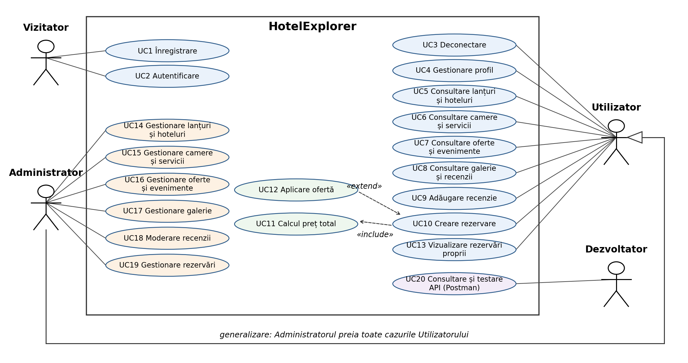

# Diagrama cazurilor de utilizare

Diagrama conține 4 actori și 20 de cazuri de utilizare. Administratorul preia toate cazurile
Utilizatorului (generalizare). Imaginea provine din Raportul 1, secțiunea 4.

## Descrierea cazurilor de utilizare

| ID | Caz de utilizare | Actor | Descriere |
|---|---|---|---|
| UC1 | Înregistrare | Vizitator | creează un cont nou, cu email și parolă |
| UC2 | Autentificare | Vizitator | se autentifică și primește acces în funcție de rol |
| UC3 | Deconectare | Utilizator | închide sesiunea |
| UC4 | Gestionare profil | Utilizator | vede datele contului și actualizează poza de profil |
| UC5 | Consultare lanțuri și hoteluri | Utilizator | vede lanțurile și hotelurile fiecărui lanț |
| UC6 | Consultare camere și servicii | Utilizator | vede tipurile de camere, prețurile și serviciile |
| UC7 | Consultare oferte și evenimente | Utilizator | vede ofertele și evenimentele unui lanț |
| UC8 | Consultare galerie și recenzii | Utilizator | vede imaginile și recenziile hotelurilor |
| UC9 | Adăugare recenzie | Utilizator | lasă un rating de la 1 la 5 și un comentariu |
| UC10 | Creare rezervare | Utilizator | alege lanțul, hotelul, camera și perioada și trimite rezervarea |
| UC11 | Calcul preț total | inclus în UC10 | calculează prețul din tariful camerei și numărul de nopți |
| UC12 | Aplicare ofertă | extinde UC10 | aplică reducerea unei oferte la prețul rezervării |
| UC13 | Vizualizare rezervări proprii | Utilizator | vede lista rezervărilor și statusul lor |
| UC14 | Gestionare lanțuri și hoteluri | Administrator | adaugă, modifică și șterge lanțuri și hoteluri |
| UC15 | Gestionare camere și servicii | Administrator | adaugă, modifică și șterge camere și servicii |
| UC16 | Gestionare oferte și evenimente | Administrator | adaugă, modifică și șterge oferte și evenimente |
| UC17 | Gestionare galerie | Administrator | adaugă, modifică și șterge imagini din galerie |
| UC18 | Moderare recenzii | Administrator | șterge recenziile necorespunzătoare |
| UC19 | Gestionare rezervări | Administrator | listează toate rezervările, le acceptă, le respinge sau le șterge |
| UC20 | Consultare și testare API (Postman) | Dezvoltator | consultă colecția Postman și testează apelurile API-ului |
